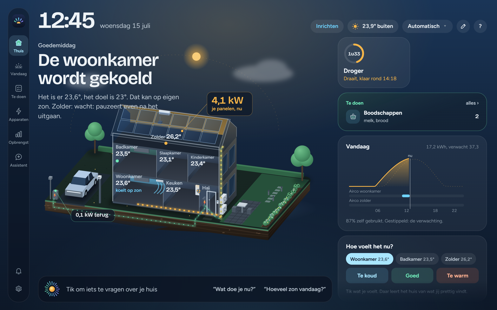
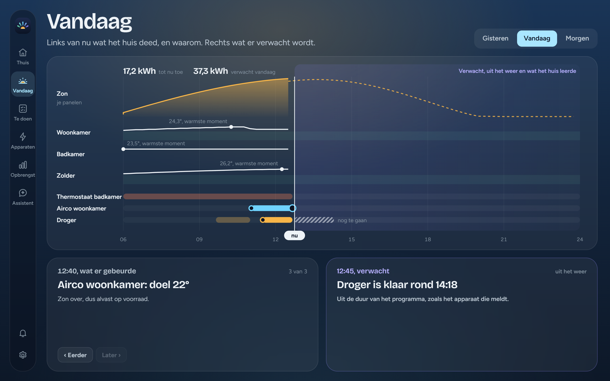
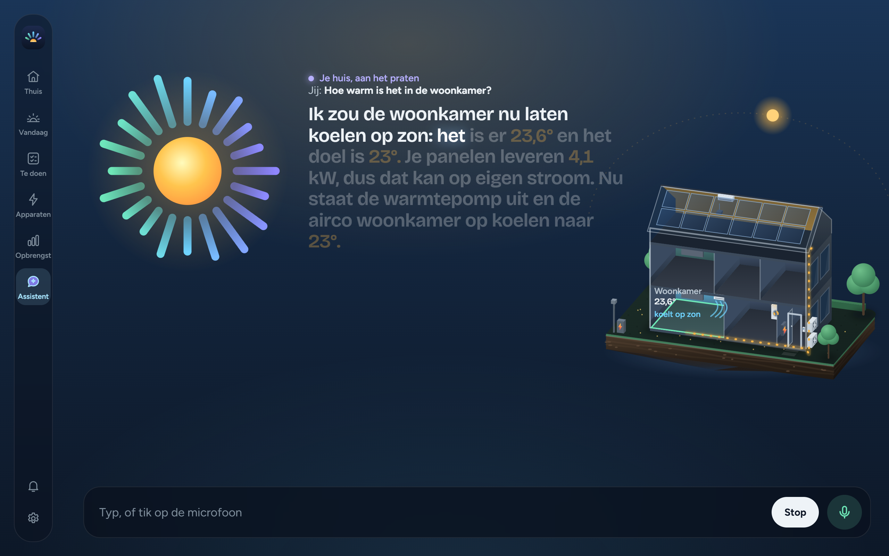
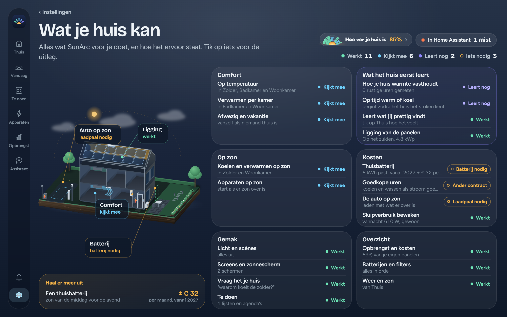
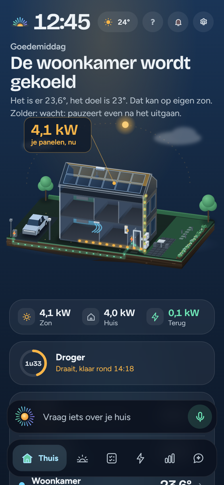

<p align="center"></p>

<h1 align="center">SunArc</h1>

<p align="center"><sub>AUTONOMOUS RESIDENTIAL CLIMATE</sub></p>

<p align="center"><b>Klimaat en zon in één app, voor Home Assistant.</b><br>
Je huis denkt mee met de zon: het kijkt naar je verwarming, airco's en zonnepanelen,<br>
en zegt bij elk besluit waarom.</p>

<p align="center">
<a href="https://my.home-assistant.io/redirect/supervisor_add_addon_repository/?repository_url=https%3A%2F%2Fgithub.com%2FRicardo-switch%2FSunARC-HA-APP"></a>
</p>

<p align="center">


<a href="https://paypal.me/sunarc"></a>
</p>

<p align="center"><a href="README.md">English</a> · <b>Nederlands</b></p>

<p align="center"></p>

<p align="center"><sub>Beelden uit de app, in het voorbeeldhuis.</sub></p>

> **Je installeert één ding: de add-on.** Daarin zit de hele app en de regeling.
> De **integratie SunArc** (de release *Assist-integratie 2.0.0 (optioneel)*) is **niet nodig**: die is er alleen om SunArc vragen te stellen via Assist van Home Assistant. De versies van de add-on zijn de releases met `0.x`.

---

## In het kort

- **Wat het is:** een add-on voor Home Assistant met een eigen app voor de tablet aan de muur en je telefoon. Het tekent je huis als een opengewerkt poppenhuis, uit wat Home Assistant al weet.
- **Wat het doet:** comfort per kamer, je eigen zonnestroom eerst in je eigen huis, en een helder beeld van energie en kosten. Bij elk besluit staat waarom, in gewone taal.
- **Waar het staat:** SunArc **kijkt mee**. Het beslist en legt alles vast, maar zet je verwarming en airco's nog niet zelf aan of uit. Echt regelen komt pas na een volledige winter meekijken, met een rapport dat bewijst dat het beter doet dan je huidige regeling. Lampen, scènes, schermen en het klimaat met de hand (altijd met een eindtijd) werken al vanuit de app.
- **Je gegevens blijven thuis.** Alles draait op je eigen Home Assistant; alleen het weerbericht wordt opgehaald.

## Inhoud

- [Wat het kan](#wat-het-kan)
- [Wat er nog niet is](#wat-er-nog-niet-is)
- [Wat je nodig hebt](#wat-je-nodig-hebt)
- [Installeren](#installeren)
- [Niet nodig: SunArc vragen via Assist](#niet-nodig-sunarc-vragen-via-assist)
- [Veilig](#veilig)
- [Hoe het werkt](#hoe-het-werkt)
- [Meebouwen](#meebouwen) · [Steunen](#steunen) · [Licentie](#licentie)

## Wat het kan

In de app staat dit alles voor je eigen huis op de pagina **Wat je huis kan**: wat werkt, wat nog leert, en wat je opstelling mist voor de rest.

### Je huis in één beeld
- **Het huis in 3D**, uit de etages, kamers en apparaten in Home Assistant. Je deelt het in per etage, kamer en zone, voegt eigen etages toe, en zet buiten de panelen, de garage of het tuinhuis neer.
- **Per kamer** de temperatuur, wat er verwarmt of koelt, en welke sensor telt.
- **Batterijen en filters:** een bijna lege batterij van een sensor of een vol airco-filter staat op Thuis, met een tik naar het apparaat.
- **Deuren en poorten** om te bekijken; open of dicht doet de app nooit.

### Comfort
- **Comfort per kamer en per dagdeel**, zoals jij het instelt.
- **Per bewoner:** de eerste op volgorde die thuis is, bepaalt het comfort. Iedereen logt in met een eigen account van Home Assistant.
- **Afwezig en vakantie:** zuiniger als niemand thuis is; vakantie zet je zelf.
- **Leert wat je fijn vindt:** tik op Thuis "te koud, goed, te warm", en het huis legt het naast de temperatuur van dat moment.
- **Hoe je huis warmte vasthoudt:** per kamer hoe snel hij afkoelt, en wat de zon en elk apparaat doen.
- **Verwarmen per kamer** met een thermostaat, slimme radiatorknoppen of een elektrische kachel, ook met één cv-ketel.

### Zon
- **Koelen en verwarmen op zon:** de airco's draaien op de stroom van je eigen panelen, als een kamer het nodig heeft.
- **Witgoed op zon:** een droger, wasmachine of vaatwasser met starten op afstand wacht op zon, en is toch klaar op de tijd die jij kiest.
- **Boiler en jacuzzi op zon:** ze verwarmen met wat er over is en houden een ondergrens vast, zodat er altijd warm water is.
- **Het weer en de zon van morgen:** per uur en per dag, met wat je panelen dan naar verwachting leveren.
- **Hoe je panelen liggen:** het huis zoekt zelf uit naar welke kant ze liggen en hoe schuin. Panelen op een garage, carport of tuinhuis tellen mee.
- **Nooit meer dan je zekering:** een stroombudget per fase, zodat de hoofdzekering het houdt. Elke zekering van 6 tot 250 A, op één of drie fasen.

### Energie en kosten
- **Vandaag:** de dag in de tijd, met wat elk apparaat deed en waarom.
- **Energie** per dag, week, maand of contractjaar: wat je gebruikt, wat je panelen leveren en wat het kost, met de prijzen van je eigen contract (normaal en dal, salderen en daarna). De meters komen zo uit het Energie-dashboard van Home Assistant.
- **De zonverwachting** naast wat er echt kwam.
- **Sluipverbruik:** elke nacht kijkt het huis wat het gebruikt als er niets draait, en zegt het als dat opvalt.
- **Een thuisbatterij, nagerekend:** nog geen batterij? De app rekent je afgelopen jaar per uur na en laat zien welke maat past. Heb je er een? Dan zie je hoe vol hij is en wat hij doet.
- **De auto:** hoe vol hij is en of hij laadt.

### Bedienen
- **Lampen en Hue-scènes**, per kamer, met een tik.
- **Screens en zonneschermen:** open, dicht, of naar elke stand gesleept.
- **Klimaat met de hand:** de thermostaat of een airco tot een tijd die jij kiest, daarna terug naar je regeling.
- **Vast en gepland:** "elke werkdag een kwartier voor zonsondergang de screens dicht", en het huis doet het steeds.
- **Camera's** in de kamer waar ze hangen, en **de deurbel** met het beeld op elk scherm als er wordt aangebeld.

### De assistent en Te doen
- **Vraag het je huis** in je eigen woorden ("waarom wacht de zolder?"), en het antwoordt hardop met de stem uit Home Assistant.
- **Helemaal in huis:** verstaan, de stem en het wekwoord **"Hé huis"** kunnen allemaal op je eigen Home Assistant draaien. Op de telefoon gebruik je de microfoon.
- **Te doen:** herinneringen, het afval, je agenda's en de boodschappen bij elkaar, in een eigen tab.

### Tablet aan de muur en telefoon
- **Eén app** voor de muur en de telefoon. Elke bewoner deelt zijn Thuis één keer in, voor de telefoon en de muur tegelijk.
- **Scherm uit als er niemand is:** met Fully Kiosk Browser op de tablet gaat het scherm uit, en weer aan als er iemand langsloopt.

### Inrichten
- **Een welkom en een inrichting van ongeveer tien minuten:** je huis groeit uit wat Home Assistant kent, en jij bevestigt wat het voorstelt.
- **Klaarzetten in Home Assistant:** per functie een lijstje van wat Home Assistant nodig heeft, zoals een slimme meter, spraak of Fully Kiosk.
- **Hoe ver je huis is:** één beeld van alles wat werkt, leert of nog ontbreekt.
- **Een voorbeeldhuis** om eerst rond te kijken, waarin elke knop werkt.
- **Een back-up** van je instellingen in één klein bestand, en weer terugzetten.
- **Nederlands en Engels.**

<table>
<tr>
<td width="50%"></td>
<td width="50%"></td>
</tr>
<tr>
<td><sub><b>Vandaag</b>: wat het huis deed, en waarom.</sub></td>
<td><sub><b>De assistent</b>: vraag het je huis.</sub></td>
</tr>
<tr>
<td></td>
<td align="center"></td>
</tr>
<tr>
<td><sub><b>Wat je huis kan</b>: alles wat SunArc voor je doet, en hoe ver het is.</sub></td>
<td align="center"><sub><b>Op je telefoon</b>: dezelfde app.</sub></td>
</tr>
</table>

## Wat er nog niet is

- **Echt regelen** van verwarming en airco's, na een winter meekijken met dertig winterdagen bewijs.
- Wat het huis deze winter leert over je cv en ventilatie, in de regeling zelf.
- **Een thuisbatterij of laadpaal sturen.** SunArc laat ze zien, maar stuurt ze niet.
- **Goedkope uren** met een dynamisch contract: koelen, verwarmen en wassen naar de goedkoopste uren schuiven.

## Wat je nodig hebt

- **Home Assistant met add-ons:** Home Assistant OS of Supervised, op een Raspberry Pi of een gewone pc (aarch64 of amd64).
- **Je eigen apparaten, van elk merk.** SunArc werkt met wat je huis heeft: een airco, een thermostaat, radiatorknoppen, een slimme meter, zonnepanelen, lampen, screens. Het doet wat jouw opstelling toelaat, en **Wat je huis kan** zegt wat er voor de rest mist.
- Voor het beste resultaat: een **slimme meter** die het vermogen van nu geeft (P1, liefst lokaal), en **ruimtes (gebieden)** in Home Assistant.

## Installeren

1. Tik op de knop **Voeg de repository toe** hierboven. Of ga naar **Instellingen → Add-ons → Add-on store**, kies rechtsboven de drie puntjes → **Repositories**, en voeg toe:
   ```
   https://github.com/Ricardo-switch/SunARC-HA-APP
   ```
2. Kies **SunArc** → **Installeren**, en daarna **Starten**. Zet **In zijbalk tonen** aan.
3. Open SunArc in de zijbalk. Een nieuw huis begint met een welkom, en met één knop ga je inrichten.

Meer heb je niet nodig. Updates komen via Home Assistant; zet op de add-on-pagina **Automatisch bijwerken** aan als dat vanzelf moet. Wat er in elke versie nieuw is, staat bij de [releases](https://github.com/Ricardo-switch/SunARC-HA-APP/releases) en in de add-on zelf.

## Niet nodig: SunArc vragen via Assist

De app heeft een eigen assistent, dus dit hoeft niet. Alleen als je SunArc ook wilt vragen via **Assist** van Home Assistant ("waarom draait de zolder?", "wat doe je nu?"), zet je de kleine integratie **SunArc** erbij. Geen YAML: de add-on meldt zich vanzelf aan.

- **Zonder HACS:** open SunArc → **Instellingen → Bewoners en toegang → Sleutel voor de assistent** en tik op **Zet de integratie in Home Assistant**. Herstart daarna Home Assistant.
- **Met HACS:** kies in HACS de drie puntjes → **Eigen repositories**, voeg `https://github.com/Ricardo-switch/SunARC-HA-APP` toe als **Integratie**, installeer **SunArc** en herstart Home Assistant. HACS installeert alleen deze integratie; de add-on komt altijd uit de add-on-winkel.

Home Assistant toont dan **Nieuw apparaat gevonden: SunArc**; klik op **Toevoegen**. Dat doe je één keer. De integratie heeft een eigen versie (2.0.0), die alleen omhoog gaat als de integratie zelf verandert; een update van SunArc vraagt geen herstart, want de zinnen en de antwoorden komen uit de add-on.

## Veilig

- De app zit achter de inlog van Home Assistant (Ingress). Er staat geen poort open, tenzij je zelf de eigen poort voor Tailscale aanzet.
- Een eigen AppArmor-profiel: beveiligingscijfer 8, het hoogste.
- De images worden op GitHub gebouwd en ondertekend met Cosign.
- SunArc schrijft naar Home Assistant alleen via smalle deuren: lampen, scènes, schermen, de startknop van witgoed dat op zon wacht, en het klimaat met de hand met een eindtijd. Een test bewijst dat er niets anders door kan. Waarom de add-on de configuratie van Home Assistant mag schrijven, staat in de uitleg van de add-on.
- Een zwakke plek gevonden? Zie [SECURITY.md](SECURITY.md).

## Hoe het werkt

- **Een pure kern.** Strategieën doen elk een voorstel (comfort, warmte bijspringen, zon over), en één arbiter beslist binnen een budget aan vermogen. De kern doet geen in- of uitvoer en leest geen klok, dus elk besluit is na te rekenen.
- **Alles wordt vastgelegd.** Elk besluit, met de stand van het huis en de versie die het nam. Daar komt het bewijs voor het echte regelen uit.
- **Wat per huis verschilt, is een instelling**, niet code. Wat Home Assistant al weet, stelt de app voor; jij bevestigt.

Meer lezen:
- [STAND.md](STAND.md): per onderwerp hoe het nu werkt.
- [DECISIONS.md](DECISIONS.md): elk besluit, met waarom en wat het kostte.
- [Architecture.md](Architecture.md): de opbouw.
- [design/app2](design/app2): de schetsen van de app. De schets is de code: de app tekent het huis met dezelfde bestanden.
- [docs/oude-regeling](docs/oude-regeling): het YAML-systeem dat SunArc vervangt.

## Meebouwen

De dienst is TypeScript op Node 22, de app gewone HTML en JavaScript met Tailwind.

```bash
cd backend && npm ci && npm test
```

Het werk gaat naar `beta`. De CI controleert elke push (typecheck, lint, tests, de pagina in een browser en het image), en naar `main` gaat het alleen via een pull request. `main` is wat Home Assistant installeert. Een fout of een idee? Open een [issue](https://github.com/Ricardo-switch/SunARC-HA-APP/issues/new/choose); Nederlands mag.

## Steunen

SunArc is gratis. Blij mee? Je kunt [trakteren op een kop koffie via PayPal](https://paypal.me/sunarc). Dank je wel!

## Licentie

SunArc is vrije software onder de [GNU Affero General Public License v3.0](LICENSE) (AGPL-3.0). Je mag het gebruiken, aanpassen en delen. Wie een aangepaste versie verspreidt, of hem als dienst of op een apparaat aanbiedt, deelt de broncode onder dezelfde licentie.

De naam SunArc en het teken vallen niet onder deze licentie.

Van anderen, elk met een eigen licentie:

- [qrcode-generator](https://github.com/kazuhikoarase/qrcode-generator) van Kazuhiko Arase, MIT: de QR-code bij Bewoners.
- De letters [Bricolage Grotesque](https://fonts.google.com/specimen/Bricolage+Grotesque) en [Figtree](https://fonts.google.com/specimen/Figtree), SIL Open Font License 1.1.
- De twee voorstappen van het wekwoord uit [openWakeWord](https://github.com/dscripka/openWakeWord) (`melspectrogram.onnx` en `embedding_model.onnx`), CC BY-NC-SA 4.0: niet voor commercieel gebruik.
